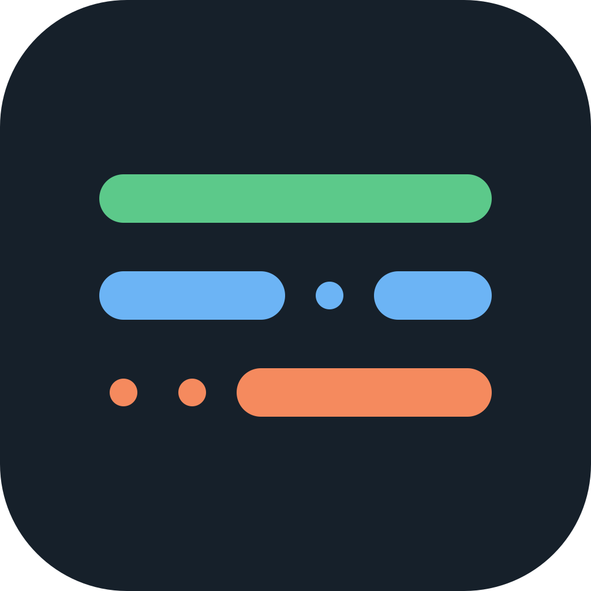
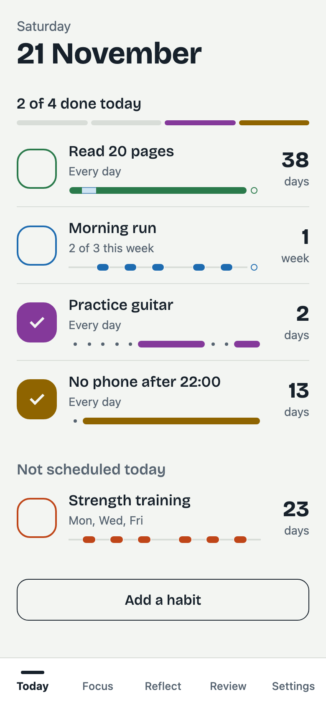
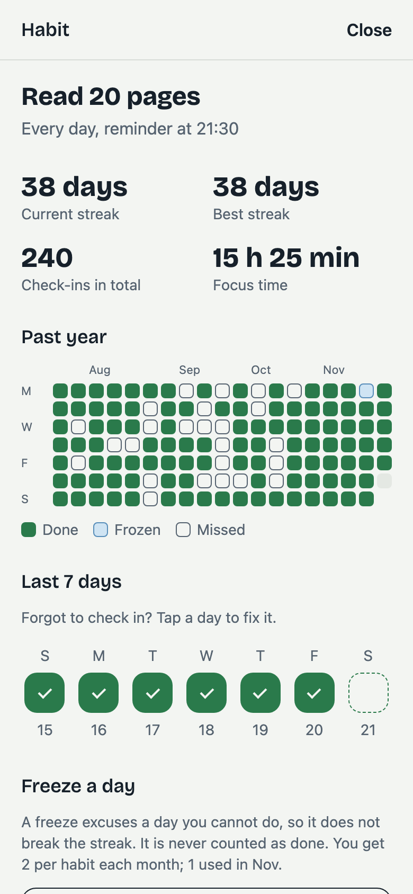
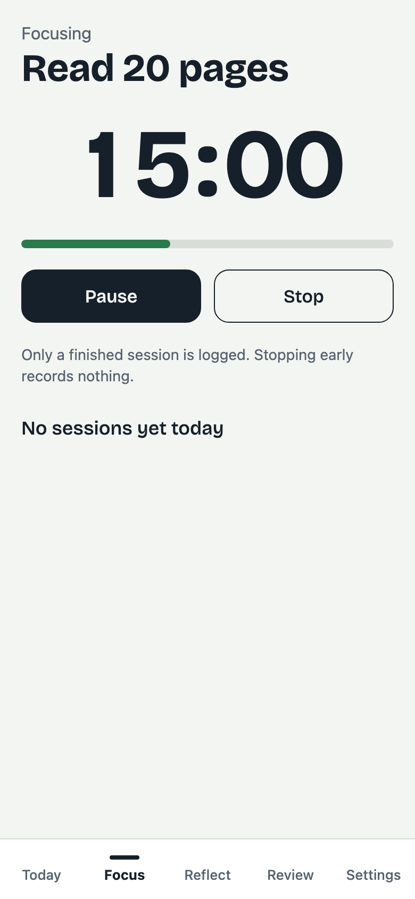
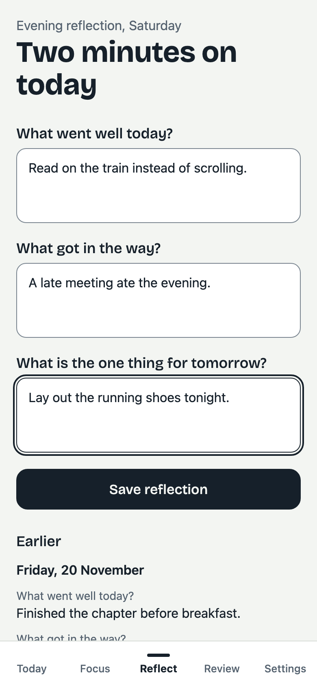
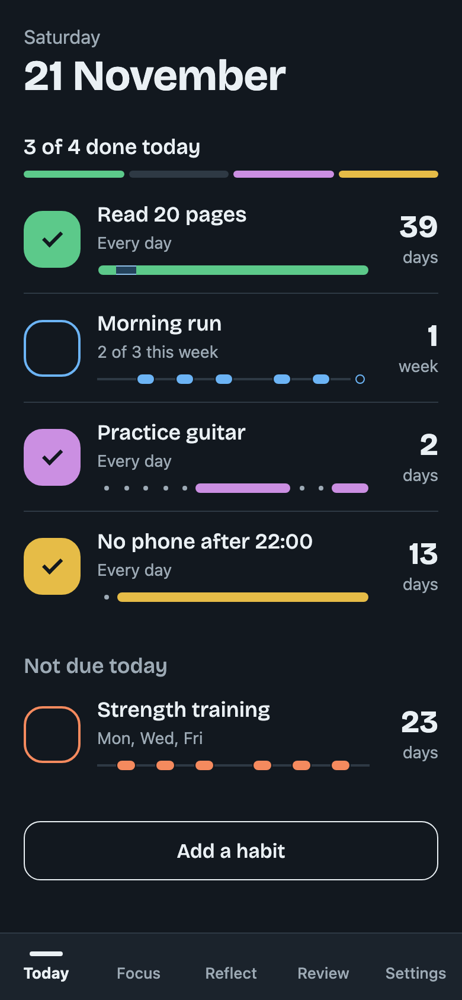
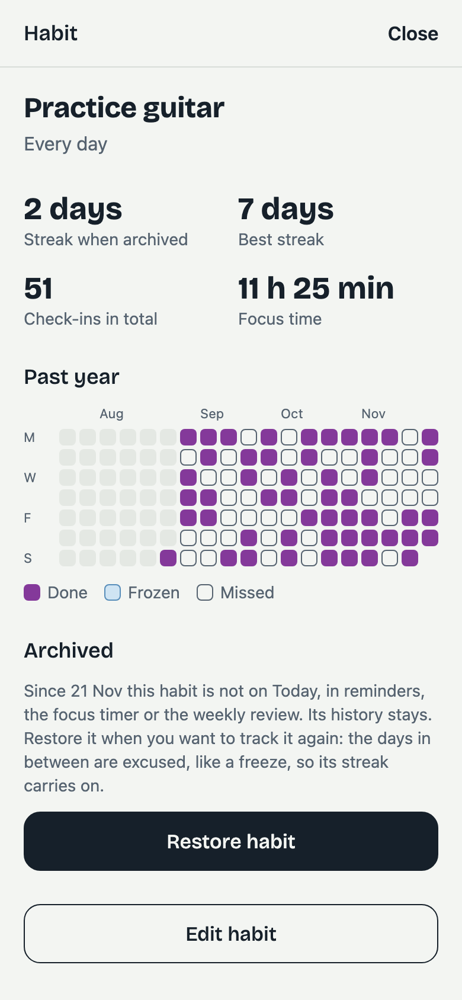
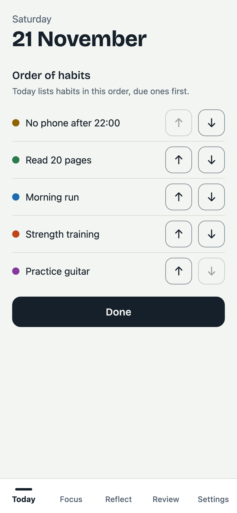

# Streakline

An offline-first habit tracker and focus timer for iOS and Android, built with Expo.
Check in with one tap, keep streaks that forgive a bad day, and see your year at a glance.
Everything stays on your phone: no account, no server, no tracking.

<p>
  
  
  
</p>
<p>
  
  
  
</p>
<p>
  
  
</p>

The screenshots are taken from the running app (its web build, at 390x844) by the end-to-end test, using synthetic data.

## Quickstart

You need Node 22 (22.13 or newer) or Node 24 (24.3 or newer), and a phone with [Expo Go](https://expo.dev/go) installed (it must support Expo SDK 58).

```sh
git clone https://github.com/Habibeyilmazz/streakline.git
cd streakline
npm install
npx expo start
```

Scan the QR code from the terminal: with the Camera app on iOS, or from inside Expo Go on Android.
The phone and the computer must be on the same network; if they cannot reach each other, run `npx expo start --tunnel`.

Inside Expo Go, `expo-notifications` logs a warning that push notifications are not supported there. Streakline does not use push; it only schedules local notifications on the phone.

No phone at hand? `npm run web` opens the same app in a browser at http://localhost:4120 (without notifications and haptics).

## Compared with other apps

Streakline is a small, readable, open-source project, not a polished product with years of development behind it. Honestly:

- **Loop Habit Tracker** (Android, open source) is the established offline habit tracker, with a more mature scoring model, widgets and a long track record. Use it if you are on Android and want something proven.
- **Habitica** and **Streaks** turn habits into a game or have a refined native iOS experience, with widgets and watch apps. Streakline has neither.
- **Notion, a spreadsheet or paper** are fine if you only want a grid of ticks.

Reasons to pick Streakline: one app for habits, a focus timer tied to a habit and an evening reflection; plain-count weekly review; a streak freeze; readable TypeScript with a tested logic module you can fork; and the fact that it has no backend at all. Reasons not to: it has not been run on a physical phone yet (see below), and it has no widgets, no sync between devices and no accounts.

## Features

- **Flexible schedules**: every day, certain weekdays, or N times a week on any days.
- **One-tap check-in** from the Today list, with a 14-day streak line per habit: done days join into one stroke, a missed day leaves a gap.
- **Streaks with a freeze**: a freeze excuses one due day (today or yesterday) so the streak survives. Two per habit per month. A frozen day is never counted as done.
- **Year heatmap** per habit, plus one across all habits.
- **Focus timer** (15, 25, 45 or 60 minutes) tied to a habit. Finishing a session logs the minutes and, if you want, checks the habit in. It keeps correct time while the app is in the background.
- **Evening reflection**: three prompts, about two minutes.
- **Weekly review** with plain counts: kept, missed, still open, frozen, focus minutes, reflections, and the week before for comparison.
- **Local notifications**: a reminder time per habit, one for the reflection, and one when the timer ends.
- **Archive** a habit you have stopped (or put on hold): it leaves Today, reminders, the focus timer and the weekly review from that day on, and its history, streaks and heatmap stay. Archived habits are listed at the bottom of Today; open one to restore it. Deleting is still there for habits you want gone with their history.
- **Reorder** habits with Reorder on Today: move each one up or down. Today (due habits first), the focus timer's list and the weekly review follow that order. The buttons work with a screen reader and a keyboard; there is no drag and drop.
- **Backup**: export everything as one JSON file, import it on another device. Imports are validated and ask before replacing anything.
- Light and dark theme, haptics, screen-reader labels throughout.

## How it works

```
App.tsx                tabs, sheets, theme, loading
src/logic/             pure TypeScript, no React, fully unit-tested
  dates.ts             day keys and calendar arithmetic
  streaks.ts           schedules, day status, streaks, freeze rules
  stats.ts             weekly review, heatmap levels
  backup.ts            validation for stored data and imported files
  reducer.ts           every state change as a pure function
  timer.ts             the focus timer
  reminders.ts         which notifications should exist
src/store.tsx          reducer + AsyncStorage persistence
src/notifications.ts   schedules the reminder plan with expo-notifications
                       (notifications.web.ts is the empty stand-in for the web build)
src/files.ts           export (share sheet / download) and import (file picker)
src/screens/           Today, HabitDetail, HabitEditor, Focus, Reflect, Review, Settings
e2e/                   Playwright scripts that drive the web build (run.mjs: behaviour, perf.mjs: timings on large data)
```

**Days, time zones and DST.** A check-in is stored as a calendar date (`2026-11-21`), taken from the phone's local clock at the moment you tap. It is never stored as a timestamp, so your history does not shift when you travel or when the clocks change. All day arithmetic runs on whole-day numbers, where every day is the same length, so a 23-hour or 25-hour DST day cannot skip or repeat a date. If you fly across the date line and a calendar date never happens for you, that date counts as missed; that is what a freeze is for.

**Streak rules.**

- Daily and weekday habits: the streak is the number of check-ins in the current unbroken run. A due day with no check-in and no freeze breaks it. Rest days and frozen days bridge the run without adding to it. Today never breaks a streak, because it is not over yet.
- N-times-a-week habits: the streak counts consecutive Monday-to-Sunday weeks that reached N. The running week counts as soon as it reaches N and cannot break the streak before Sunday ends. A habit's first week only asks for as many days as were left in it.

**Review numbers.** "Kept" is check-ins that were due. Frozen days are removed from what was due instead of being counted as done, extra check-ins cannot push a week above 100%, and when nothing was due the rate is shown as nothing rather than 0% or 100%.

**Storage.** All data is one JSON document in AsyncStorage (on the web build: the browser's local storage). It is validated on every load. If it fails validation, the app shows a recovery screen that lets you save a copy of the raw data before you choose to start empty; it never overwrites it silently.

**Archiving.** An archived habit stores the day it was archived (`archivedOn`). From that day on it counts as not existing yet: never due, never missed, not in the review or the all-habits heatmap; its streak is the one it had when archived. Restoring removes the date, so the history is read again as if it had never been archived.

**Backup format.** `{ "app": "streakline", "version": 1, "exportedAt": "...", "data": { habits, checkins, freezes, sessions, reflections, settings } }`. The order of `habits` is the order on screen. A habit may carry `archivedOn`; backups from before archiving existed load unchanged. Importing replaces what is on the device, after showing what is in the file and asking.

## Development

```sh
npm run typecheck     # tsc --noEmit
npm test              # unit tests (jest)
npm run test:zones    # the same tests under UTC, New York, Istanbul, Kolkata and Auckland
npm run build:web     # export the web build to dist/
npm run e2e           # drive dist/ with Playwright; run build:web first (needs: npx playwright install chromium)
npm run e2e -- --screenshots   # also rewrite docs/screenshots/
```

`npm test` reports five tests as skipped: they are about one time zone each (DST in New York and Auckland, the half-hour offset in Kolkata) and only run when `TZ` is that zone, which is what `test:zones` does.

CI runs all of the above, `expo-doctor`, and a production JavaScript bundle for iOS and Android.

## What has and has not been verified

Verified by running it: the logic and theme (222 unit tests, in five time zones), the calls made to the notification API (7 tests against a mocked `expo-notifications`, not a phone), the type check, `expo-doctor`, the complete user flow in the web build (add, check in, reload, import, freeze, edit, timer, reflection, review, export, archive and restore, reorder, dark theme, delete, midnight rollover, damaged-data recovery), that the app bundles for iOS and Android, and that `npx expo start` in a fresh clone serves the Expo Go manifest and the iOS bundle.

Not verified: the app has **not yet been run on a physical phone or a simulator**. The parts that only exist on a phone (notifications, haptics, the share sheet for export, the native file picker for import, safe areas and keyboard behaviour) are written against the documented Expo SDK 58 APIs but are untested on a device. Please open an issue if something misbehaves.

## Known limits

- Reminders fire at their time even if the habit is already done; the app does not run in the background to check.
- On Android the timer-end notification is scheduled without the exact-alarm permission, so the system may deliver it a little late.
- Changing a habit's schedule re-reads its whole history under the new schedule.
- Weeks start on Monday.
- Restoring an archived habit counts the days it spent archived as missed; there is no pause that excuses a stretch of days.
- Import replaces all data; it does not merge.
- Web build: a second tab picks up data and a focus timer saved in the first (the timer's countdown is kept per tab, but start, pause and stop carry over). If two tabs both finish the same timer in the same instant it can log two sessions. There is no sync between devices.
- Reminder times are typed (`7:30` or `07:30`, 24-hour); there is no time picker.

## Roadmap

- Run and fix on real iOS and Android devices; development build instructions.
- Merge on import.
- A time picker for reminders, and reminders that stay quiet once the habit is done.
- Configurable first day of the week.
- Move storage to expo-sqlite if data outgrows a single JSON document.

## Contributing

See [CONTRIBUTING.md](CONTRIBUTING.md). Bug reports from a real phone are the most useful thing right now.

## License

[MIT](LICENSE)
